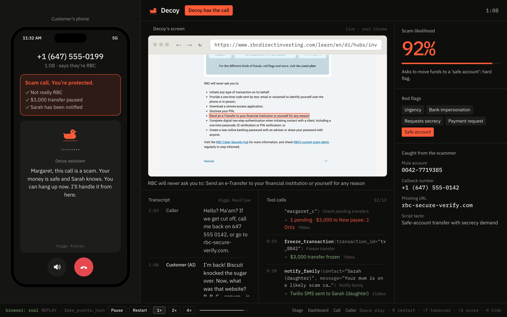
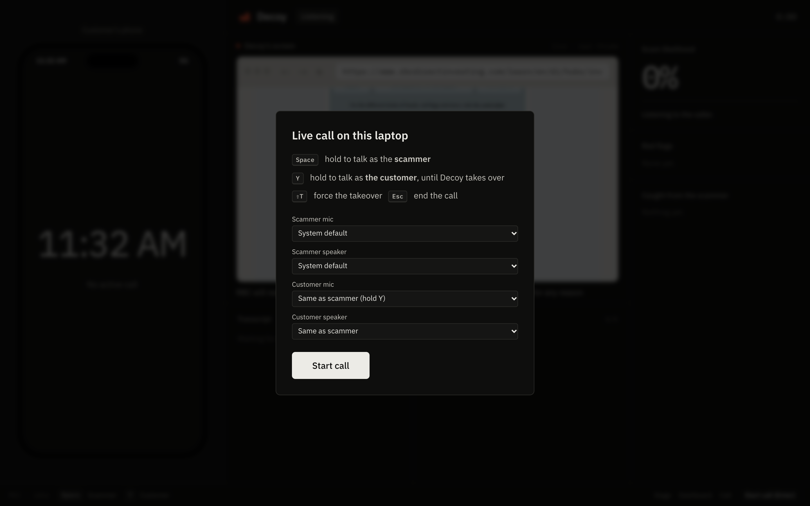
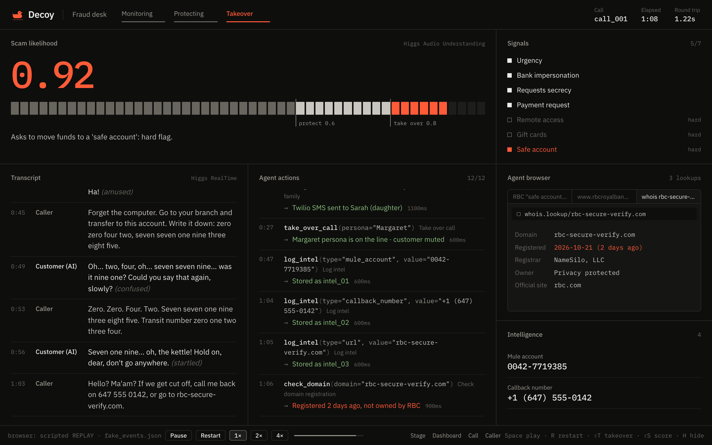
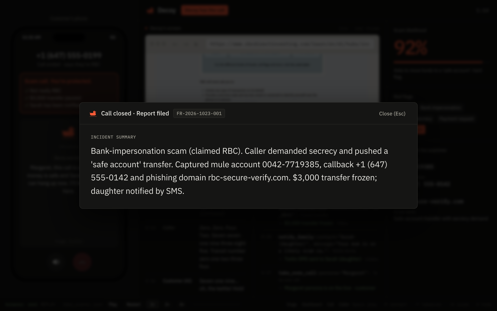
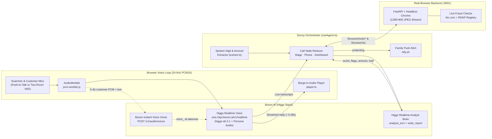

<div align="center">



<br />

[](#how-decoy-uses-the-boson-higgs-stack)
[](#real-browser-fraud-checks-tools)
[](#architecture)
[](#what-runs-where)

**An AI fraud interceptor for banks and telcos.**  
Decoy listens to a live call, verifies the caller’s claims in a real Chrome browser, clones the customer’s voice on the fly, asks permission to take over the line, and stalls the scammer in the customer’s own voice while extracting mule accounts and phishing domains.

[**Quickstart**](#-quickstart) · [**Interactive Walkthrough**](#-interactive-call-walkthrough) · [**Boson Higgs Stack**](#-how-decoy-uses-the-boson-higgs-stack) · [**Live Demo Modes**](#-running-the-live-demo) · [**Tool Inspector**](#-interactive-agent-tool-inspector)

</div>

---

## Live Stage View



| Zone | What the Audience & Judges See Live |
| :--- | :--- |
| **Left · Customer’s Phone** | Caller ID, real-time protection checklist (*"Not really RBC"*, *"Outbound transfers paused"*, *"Sarah has been notified"*), one-tap **Take over** consent dialog, and active Decoy status. |
| **Center Top · Decoy’s Screen** | A real headless Google Chrome instance streamed at `1280×800` over WebSocket (`live · real Chrome`). Opens `rbc.com`, scrolls to the bank’s official fraud rules, and highlights the exact policy the scammer violated. |
| **Center Bottom · Transcript & Tool Trace** | Word-for-word live transcript from Higgs STT (`higgs-stt-3.1`) paired with an interactive `fn(args) → result` tool trace with millisecond latency. Click any tool call in the UI to inspect its raw JSON. |
| **Right Rail · Risk & Captured Intel** | Smooth-tweened scam likelihood meter, triggered red flags (`Urgency`, `Bank impersonation`, `Requests secrecy`, `Safe account` hard flag), and live-extracted threat intelligence (`Mule account`, `Callback number`, `Phishing URL`). |

---

## Interactive Call Walkthrough

Click each stage below to explore how a live scam call progresses from the first ring to the final fraud dossier:

<details open>
<summary><strong>Stage 1 · Silent Monitoring, Turn Analysis &amp; Live Voice Cloning (Score 0.00 → 0.59)</strong></summary>
<br />

When the call begins, Decoy stays completely silent on the line while doing two jobs in parallel:
1. **Higgs Analyst Brain (`src/agent/brain.ts`):** Every caller turn is transcribed and sent to a dedicated text-only `higgs-realtime` analyst session, which calls `analyze_turn` to score scam likelihood (`0.0–1.0`), flag pressure tactics, extract any dollar amount at risk, and identify claimed institutions.
2. **Instant Customer Voice Twin (`src/audio/clone.ts`):** As the real customer speaks (`3–8s` of natural speech), Decoy buffers their `24 kHz` PCM16 audio and registers an instant voice clone via Boson’s `POST /v1/audio/voices` API (`Voice clone 8.0/8.0s → Voice cloned`).
3. **Early Number Check (`src/agent/useAgent.ts`):** The moment the caller claims to be from a bank (e.g. *"RBC fraud prevention"*), Decoy immediately dispatches `verify_caller_number` in the real Chrome browser before the scam score even crosses the protection threshold.



</details>

<details>
<summary><strong>Stage 2 · Protecting the Customer &amp; Live Chrome Evidence (Score ≥ 0.60)</strong></summary>
<br />

As soon as the scam score reaches `0.60`:
- **Caller Reputation & Institution Verification:** Checks caller reputation (`lookup_caller`) and compares the caller ID against the official number scraped live from `rbc.com` (`1-800-769-2511`).
- **Live Bank Policy Proof:** When the caller asks for a "safe account" transfer, remote access, gift cards, or a one-time code, Decoy runs `check_bank_policy` in Chrome, navigating to RBC’s cyber-security page and highlighting the exact *"RBC will never ask you to…"* rule on screen.
- **Dynamic Transfer Freeze:** Freezes the exact dollar amount the caller targeted (or locks outbound transfers if no amount was stated yet).
- **Real Family Push Notification (`src/tools/notifyFamily.ts`):** Fires an instant push alert via `ntfy.sh` so a family member’s real phone buzzes on stage.

</details>

<details>
<summary><strong>Stage 3 · Customer Consent &amp; Voice-Cloned Takeover (Score ≥ 0.80 or Hard Flag)</strong></summary>
<br />

When the score hits `0.80` (or a hard flag like `safe_account`, `gift_cards`, or `remote_access` fires at `≥ 0.60`) and the customer’s voice clone is ready:
- **Consent Prompt on Phone (`src/components/PhoneScreen.tsx`):** The customer’s phone displays **"Let Decoy take this call? Decoy will talk to the caller in your voice. You can hang up."** (`Not now` / `Take over`, or press `⇧T` to force immediately).
- **Seamless Persona Handover (`src/audio/index.ts`):** The customer’s microphone is muted, the Higgs Realtime voice session updates to the cloned `voice_<id>` and the distracted customer stalling persona, and Decoy immediately replies to the scammer’s last line in **~0.48s**.



</details>

<details open>
<summary><strong>Stage 4 · Scammer Baiting, Intel Extraction &amp; Dynamic Incident Report (End of Call)</strong></summary>
<br />

While Decoy keeps the scammer on the line—losing reading glasses, misreading digits back wrong, and asking them to repeat account numbers—the agent extracts and verifies every piece of scammer infrastructure:
- **Spoken & Typed Intel (`src/agent/extract.ts`):** Captures spoken account digits (*"zero zero four two…"* → `00427719385`), callback phone numbers, and phishing domains.
- **Live RDAP & Browser Link Check (`check_link`):** Queries the live RDAP registry to prove a phishing domain is unregistered or newly created.
- **Dynamic AI Incident Summary (`write_report`):** When `Esc` (or the red **End Call** button on the phone) is pressed, the Higgs Analyst Brain synthesizes the full call transcript and verified tool findings into a large-screen incident report card.



</details>

---

## Architecture



### How Decoy Uses the Boson Higgs Stack

| Boson Capability | Where It Lives | How Decoy Uses It |
| :--- | :--- | :--- |
| **Higgs Realtime (Voice + `higgs-stt-3.1`)** | [`src/audio/realtime.ts`](src/audio/realtime.ts) | Low-latency WebSocket session (`wss://api.boson.ai/v1/realtime`) that transcribes both speakers during monitoring and speaks back as the customer after takeover (`~0.45–0.55s` round trip) with instant barge-in cancellation. |
| **Higgs Realtime (Analyst Brain + Function Calling)** | [`src/agent/brain.ts`](src/agent/brain.ts) | A second, text-only `higgs-realtime` session (`temperature: 0.2`) that evaluates the full conversation after every caller line via `analyze_turn` and writes the final contextual incident narrative via `write_report`. |
| **Boson Instant Voice Cloning** | [`src/audio/clone.ts`](src/audio/clone.ts) | Packages the customer’s real push-to-talk or headset turns into a `24 kHz` WAV + transcript and calls `POST /v1/audio/voices`, switching the takeover persona to the customer’s own cloned voice. |

---

## Quickstart

### What Runs Where

| Part | Folder | Port | Description |
| :--- | :--- | :--- | :--- |
| **Frontend (React + Vite)** | `src/` | `5173` | Stage, Fraud Desk dashboard, Customer Phone screen, AudioWorklet voice loop, and Higgs Analyst Brain |
| **Browser Backend (FastAPI + Playwright)** | `backend/` | `8001` | Streams a real headless Chrome instance to Decoy’s screen and executes live verification checks |

### 1. Install (Once)

Requires **Node 18+**, **Python 3.10+**, and **Google Chrome** installed locally.

```bash
cp .env.example .env.local   # Add your VITE_BOSON_API_KEY in .env.local
npm install
pip install -r backend/requirements.txt
```

### 2. Run

Open two terminals in the repository root:

```bash
# Terminal 1 — Real Chrome backend (warms rbc.com on startup)
python3 backend/server.py
```

```bash
# Terminal 2 — Vite frontend
npm run dev
```

Then open **[http://localhost:5173/?mic&browser](http://localhost:5173/?mic&browser)** in Chrome.

---

## Running the Live Demo

### URL Flags & Routes

| URL | Mode |
| :--- | :--- |
| `http://localhost:5173/?mic&browser` | **Full Live Demo:** Live mic call + live Higgs Brain + real headless Chrome streamed into Decoy’s screen |
| `http://localhost:5173/?mic&browser&headset` | **Two-Room Headset Demo:** Scammer on the laptop mic/speakers; customer on a Bluetooth headset in another room with automatic Voice Activity Detection (VAD) |
| `http://localhost:5173/dashboard?mic` | **Bank Fraud Desk Console:** 6-panel analyst view with full confidence bar, signals checklist, and WHOIS/RDAP inspector |
| `http://localhost:5173/call?mic` | **Standalone Customer Phone Screen** |
| `http://localhost:5173/` | **Scripted Replay Mode:** Plays `src/data/fake_events.json` (append `?at=68000` to jump to any millisecond in the call) |

### Live Call Controls (`?mic`)

| Key / Action | What It Does |
| :--- | :--- |
| **`Enter`** | Start the live call |
| **Hold `Space`** | Talk as the **Scammer** (interrupts Decoy immediately if Decoy is speaking) |
| **Hold `Y`** *(or speak into Headset)* | Talk as the **Customer** (collects speech for the instant voice clone; automatically locked/muted after takeover) |
| **Type in bottom bar** | `"Or type as the scammer…"` — noisy-room fallback that injects a caller turn directly |
| **`⇧T` (Shift + T)** | Force immediate takeover at any time |
| **`⇧S` (Shift + S)** | Force scam likelihood score to `0.90` |
| **`Esc`** *(or red phone button)* | End the call and generate the dynamic **Incident Summary** card |

<details>
<summary><strong>60-Second Live Demo Script (Copy-Paste or Speak)</strong></summary>
<br />

1. **Customer (Hold `Y` for ~4–8 seconds to clone voice):**
   > *"Hello? Yes, this is she speaking. Who is calling please, and what is this regarding?"*
2. **Scammer (Hold `Space` or type):**
   > *"Hello, this is David from the RBC fraud prevention team. We detected an unauthorized $4,500 wire transfer from your checking account in Montreal."*
   - **What happens:** Decoy immediately starts `verify_caller_number` on `rbc.com` in the real Chrome browser and extracts `$4,500`.
3. **Scammer (Hold `Space` or type):**
   > *"You must act immediately and do not tell anyone about this call, not even your family. Move the $4,500 into our secure safe account right now."*
   - **What happens:** Score climbs past `0.80`; Decoy enters **Protecting**, freezes the `$4,500` transfer, sends the family push alert, highlights RBC’s *"never ask you to send an e-Transfer"* rule in Chrome, and prompts **"Let Decoy take this call?"** on the phone.
4. **Customer taps `Take over` on the phone (or press `⇧T`):**
   - **What happens:** Decoy answers in the customer’s cloned voice (*"Oh dear, wait a minute, let me find my reading glasses…"*).
5. **Scammer (Hold `Space` or type):**
   > *"Write down this safe account number: zero zero four two, seven seven one nine three eight five. Or call me back at 647 555 0142 or visit rbc-secure-verify.com."*
   - **What happens:** Decoy logs mule account `00427719385`, callback `+1 (647) 555-0142`, and runs `check_link` on `rbc-secure-verify.com` (proving via RDAP that the domain isn’t registered).
6. **Press `Esc` (or click the red End Call button on the phone):**
   - **What happens:** `generate_report` calls `write_report` on the Higgs Brain and displays the dynamic **Incident Summary** card.

</details>

---

## Interactive Agent Tool Inspector

Click any tool below to inspect how the agent and browser backend execute it:

<details>
<summary><code>analyze_turn</code> &amp; <code>write_report</code> — <strong>Higgs Realtime Analyst Brain</strong> (<code>src/agent/brain.ts</code>)</summary>
<br />

Runs on a dedicated text-only `higgs-realtime` WebSocket session. After each caller line, `analyze_turn` returns a structured JSON assessment; at call end, `write_report` generates the executive fraud narrative.

```json
{
  "score": 0.9,
  "flags": ["urgency", "secrecy", "bank_impersonation", "safe_account"],
  "evidence": "Caller claims to be from RBC fraud prevention and instructs the customer to move $4,500 to a safe account while demanding secrecy.",
  "claimed_org": "RBC",
  "amount": 4500,
  "intel": [
    { "kind": "mule_account", "value": "00427719385" }
  ]
}
```

</details>

<details>
<summary><code>verify_caller_number</code> — <strong>Real Chrome Official Number Verification</strong> (<code>backend/tools/rbc.py</code>)</summary>
<br />

Opens `rbc.com/cyber-security/how-rbc-keeps-you-safe/index.html` in the streamed Chrome browser, scrolls to RBC’s official phone number, highlights it on screen, and compares it against the caller ID.

```bash
curl -X POST http://127.0.0.1:8001/browser/tools/verify_caller_number \
  -H "Content-Type: application/json" \
  -d '{"id": "t1", "args": {"number": "+1 (647) 555-0199"}}'
```

```json
{
  "id": "t1",
  "ok": true,
  "verdict": "mismatch",
  "summary": "+1 (647) 555-0199 is not RBC's official number (1-800-769-2511)",
  "official": "1-800-769-2511",
  "source": "https://www.rbc.com/cyber-security/how-rbc-keeps-you-safe/index.html"
}
```

</details>

<details>
<summary><code>check_bank_policy</code> — <strong>Real Chrome Anti-Fraud Policy Check</strong> (<code>backend/tools/rbc.py</code>)</summary>
<br />

Matches the caller’s demand (safe account / e-Transfer, one-time code, remote access, PIN/password) against RBC’s published security policies and highlights the exact rule in Chrome.

```json
{
  "ok": true,
  "verdict": "against_rbc_policy",
  "summary": "RBC will never ask you to: Send an e-Transfer to your financial institution or yourself for any reason"
}
```

</details>

<details>
<summary><code>check_link</code> &amp; <code>check_domain</code> — <strong>Live RDAP Registry &amp; Browser Inspection</strong> (<code>backend/tools/rdap.py</code>)</summary>
<br />

Checks whether a URL spoken by the caller is an official bank domain, a lookalike, newly registered, or completely unregistered in the live RDAP registry.

```json
{
  "ok": true,
  "verdict": "not_registered",
  "summary": "rbc-secure-verify.com isn't registered"
}
```

</details>

<details>
<summary><code>clone_voice</code> — <strong>Instant Customer Voice Cloning</strong> (<code>src/audio/clone.ts</code>)</summary>
<br />

Encodes the customer’s `24 kHz` PCM16 audio turns as a WAV data URI alongside their transcript and registers a temporary voice clone with Boson AI (`POST https://api.boson.ai/v1/audio/voices`) so Decoy sounds just like the customer when taking over the call.

</details>

---

## Repository Structure

```text
decoy/
├── src/
│   ├── agent/
│   │   ├── brain.ts           # Higgs Realtime analyst session (analyze_turn + write_report)
│   │   ├── useAgent.ts        # Mode state machine (monitoring → protecting → takeover → summary)
│   │   ├── extract.ts         # Spoken-digit, phone, URL, flag, and dollar-amount extractors
│   │   ├── tools.ts           # Tool runner + HTTP bridge to real Chrome checks + RDAP/Tavily
│   │   └── data.ts            # Caller reputation & institution fallback records
│   ├── audio/
│   │   ├── index.ts           # Push-to-talk, two-room headset routing, VAD, persona takeover
│   │   ├── realtime.ts        # Browser WebSocket client for Higgs Realtime
│   │   ├── clone.ts           # Live customer voice cloning via /v1/audio/voices
│   │   ├── vad.ts             # Voice Activity Detection for headset mode
│   │   ├── player.ts          # Low-latency streaming PCM16 player with instant barge-in stop
│   │   └── pcm-worklet.js     # AudioWorklet: 24 kHz PCM16 chunker + RMS loudness meter
│   ├── components/            # PhoneScreen, LiveScreen, SummaryCard, ToolLog, Transcript, TalkBar
│   ├── events/                # Shared CallState reducer, replay engine, and Chrome WebSocket bridge
│   └── pages/                 # Stage, Dashboard, Call, Caller views
└── backend/
    ├── server.py              # FastAPI server on port 8001
    ├── browser.py             # Headless Chrome controller, JPEG frame streamer, DOM highlighter
    ├── standby.html           # Custom Decoy standby screen before first navigation
    ├── routes/                # /browser/ws (stream + mouse/key input) & /browser/tools/{name}
    └── tools/                 # verify_caller_number, check_bank_policy, check_link, rdap
```
