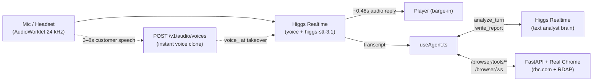

#  Decoy

*Scammers think they've found a sitting duck; it's a decoy.*

Decoy is an AI fraud interceptor built on Boson's Higgs stack. It listens to a live call, clones the customer's voice from their first few turns, checks the caller's claims in a real Chrome browser, freezes risky transfers, and—once the customer taps **Take over** on their phone—answers the scammer in the customer's own voice while pulling out mule account numbers and phishing links.


On screen: the customer's phone on the left, a real headless Chrome checking `rbc.com` in the middle, the live transcript and tool trace below it, and the scam score, red flags and captured intel on the right.

## What runs where

| Part | Where | Port |
| --- | --- | --- |
| Frontend (React + Vite): stage, dashboard, phone screen, voice loop, Higgs analyst brain | `src/` | 5173 |
| Browser backend (Playwright + FastAPI): one headless Chrome streamed to Decoy's screen, and the fraud checks that run on it | `backend/` | 8001 |

The voice call and the analyst brain talk to Boson straight from the browser (`wss://api.boson.ai/v1/realtime` and `POST /v1/audio/voices`). The Python backend is only for Decoy's live Chrome screen and its web checks.

## Setup (once)

Needs Node 18+, Python 3.10+ and Google Chrome installed (Playwright drives your installed Chrome, so there is no separate browser download).

```bash
cp .env.example .env.local                 # put your Boson key in VITE_BOSON_API_KEY
npm install
pip install -r backend/requirements.txt
```

On Windows PowerShell, use `Copy-Item .env.example .env.local`, and `npm.cmd` instead of `npm` if scripts are blocked.

## Run

Two terminals, both in the repo root:

```bash
python backend/server.py   # browser backend, ready when it prints "Uvicorn running on http://127.0.0.1:8001"
npm run dev                # frontend
```

Then open **http://localhost:5173/?mic&browser** in Chrome.

| URL | What it does |
| --- | --- |
| `/?mic&browser` | Live call with your mic + real Chrome streamed into Decoy's screen |
| `/?mic&browser&headset` | Two-room call: scammer on this laptop, customer on a Bluetooth headset in another room |
| `/dashboard?mic` | The six-panel bank fraud desk console |
| `/call?mic` | Standalone customer phone screen |
| `/` | Scripted replay of `src/data/fake_events.json` (`?at=68000` jumps to 1:08 in the call) |

Check the browser backend is connected: Decoy's screen says **"live · real Chrome"** in its top-right corner.

## Using it

**Call** (`?mic`):
- Press **Enter** to start.
- Hold **Space** to talk as the scammer (or type into *"Or type as the scammer…"* in the bottom bar).
- Hold **Y** to talk as the customer—or in two-room headset mode, just speak into the headset. As the customer talks, Decoy collects 3–8 seconds of speech and clones their voice (`Voice clone 8.0s → Voice cloned`).
- At `0.60` scam likelihood, Decoy enters **Protecting**: verifies the caller's number on the bank's live site, checks the bank's fraud rules, freezes the transfer, and sends a family push alert via `ntfy`.
- At `0.80` (or a hard flag like `safe_account`), the phone asks **"Let Decoy take this call?"** Tap **Take over** (or press **Shift+T**): the customer's mic mutes and Decoy takes over the conversation in their cloned voice.
- Press **Esc** (or the red hang-up button on the phone) to end the call and generate the incident summary from the call transcript.

<details>
<summary><strong>Screenshots: audio setup, fraud desk, and end-of-call report</strong></summary>
<br />

**Start card & two-room audio picker (`/?mic&browser`)**  
Pick separate mics and speakers for the scammer and the customer, or run on one shared mic with `Space` and `Y`.


**Fraud desk (`/dashboard`)**  
The bank analyst view with the confidence bar, signal breakdown, tool trace, WHOIS/RDAP lookup, and captured intel.


**End-of-call incident report**  
When the call ends, the Higgs analyst brain writes an incident summary from the transcript and verified tool results.


</details>

<details>
<summary><strong>How the voice loop, brain, and browser fit together</strong></summary>



- **Two Higgs Realtime sessions run in parallel:** one handles the spoken call (`src/audio/realtime.ts`), and a second text-only session (`src/agent/brain.ts`) scores each caller turn (`analyze_turn`) and writes the closing report (`write_report`).
- **Decoy's screen (`&browser`):** starts on `decoy://standby` (`backend/standby.html`) and opens real pages when a check runs. You can also type a URL, click, scroll, or use ← → ↻ directly on the canvas. Cookie banners are hidden via CSS injection (`COOKIE_BANNERS` in `backend/browser.py`) rather than clicked.

</details>

<details>
<summary><strong>Real-browser fraud checks &amp; HTTP API (<code>backend/tools/</code>)</strong></summary>
<br />

Three checks run on the real Chrome instance so Decoy's screen shows the page opening and highlights the evidence:

| Tool | Args | What it does | Verdicts |
| --- | --- | --- | --- |
| `verify_caller_number` | `number` | Finds RBC's official number on `rbc.com`'s fraud page and compares it with the caller's | `match`, `mismatch` |
| `check_bank_policy` | `claim` | Finds RBC's own *"RBC will never ask you to…"* rule for what the caller asked for (e-Transfer / safe account, one-time code, remote access, PIN, password) | `against_rbc_policy`, `no_policy_found` |
| `check_link` | `url` | Checks whether a domain is official RBC, unregistered, newly registered (RDAP), or a lookalike | `official`, `not_registered`, `new_domain`, `lookalike`, `not_rbc` |

Call them over HTTP (from the frontend, Vite proxies `/browser/tools/...` to port `8001`):

```bash
curl http://127.0.0.1:8001/browser/tools          # list the tools as function-calling schemas
curl -X POST http://127.0.0.1:8001/browser/tools/verify_caller_number \
  -H "Content-Type: application/json" \
  -d '{"id": "t3", "args": {"number": "+1 (647) 555-0199"}}'
```

```json
{"id": "t3", "ok": true, "verdict": "mismatch",
 "summary": "+1 (647) 555-0199 is not RBC's official number (1-800-769-2511)",
 "official": "1-800-769-2511", "excerpt": "...", "source": "https://www.rbc.com/cyber-security/how-rbc-keeps-you-safe/index.html"}
```

### Adding a browser tool

1. **Backend:** write `async def my_check(args, rid) -> dict` in `backend/tools/`, then add a `Tool(...)` to `REGISTRY` in `backend/tools/__init__.py`. It's served at `POST /browser/tools/my_check` with no route changes.
2. **Warm its pages:** if the tool opens fixed pages, list them in the Tool's `warm=(...)`. At startup the backend loads them once in a hidden tab, so the first check during a call doesn't pay for a cold page load.
3. **Frontend:** add the name to `REAL_CHECKS` in `src/agent/tools.ts`, call it from `src/agent/useAgent.ts` with `tools.realCheck(...)` (when `bridge.connected`), and add its label and result text to `TOOL_LABEL` / `describeResult` in `src/components/format.ts`.

</details>

## More

- [`HANDOFF.md`](HANDOFF.md): team handoff, voice loop details, and family push alert setup (`VITE_NTFY_TOPIC`).
- [`fraud-interceptor-brief.md`](fraud-interceptor-brief.md): the original build brief.
